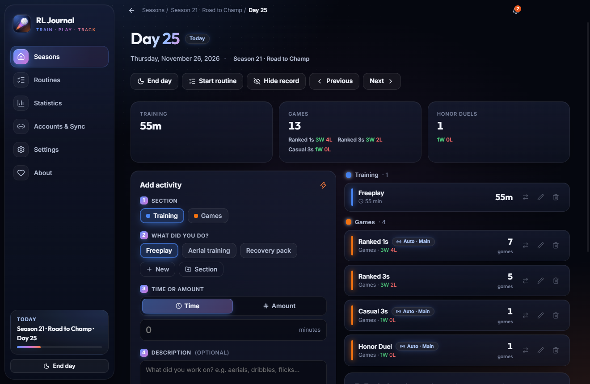
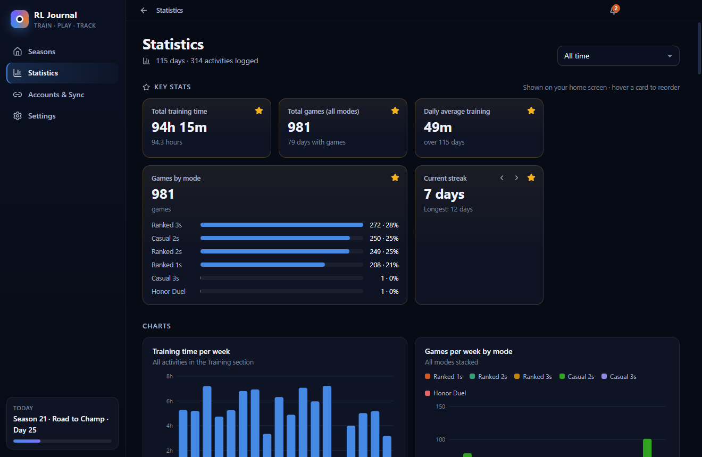
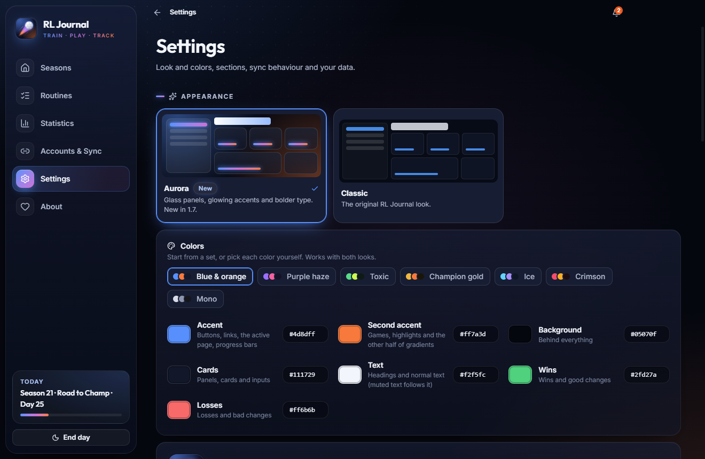

# RL Journal

**A training and games journal for Rocket League, for Windows and Linux.**

Plan your season, log what you practise every day, and let your games log themselves while you play. Then see exactly how much you train, what you play, and how you're doing.


## Download

| | Windows 10 / 11 | Linux (x86_64) |
|---|---|---|
| **File** | `RL-Journal-Setup-<version>.exe` | `RL-Journal-x86_64.AppImage` |
| **Get it** | [Latest release](https://github.com/GAGBI123/rl-journal/releases/latest) | [Download AppImage](https://github.com/GAGBI123/rl-journal/releases/latest/download/RL-Journal-x86_64.AppImage) |

Free and open source ([MIT](LICENSE)). See the [code signing policy](#code-signing-policy) and [privacy policy](#privacy-policy).

### Install on Windows

1. Download `RL-Journal-Setup-<version>.exe` from the [latest release](https://github.com/GAGBI123/rl-journal/releases/latest).
2. Run it. Until code signing is active (see the [code signing policy](#code-signing-policy)), Windows may say *"Windows protected your PC"*. Click **More info → Run anyway**.
3. Pick where to install, and RL Journal opens. It's in your Start menu and on your desktop.

### Install on Linux

1. Download [`RL-Journal-x86_64.AppImage`](https://github.com/GAGBI123/rl-journal/releases/latest/download/RL-Journal-x86_64.AppImage). Keep it somewhere permanent, such as `~/Applications`.
2. Allow it to run: right-click → **Properties** → **Permissions** → tick *Allow executing file as program* (or run `chmod +x RL-Journal-x86_64.AppImage`).
3. Double-click it. On first start it adds **RL Journal** to your app menu, so after that you can open it like any other app.

Works on any modern 64-bit distribution (Arch / CachyOS, Fedora, Ubuntu, Debian, openSUSE…), no extra libraries needed.

### Updates

RL Journal updates itself. New versions are downloaded in the background and installed when you're not in a match or using the app, and you get a message when it's done. You can turn that off in **Settings → App & updates** and install updates with one click instead.

Your journal is never replaced, not by updates and not by running the installer again.

### Uninstall

- **Windows:** Settings → Apps → **RL Journal** → Uninstall. Your journal stays in `%APPDATA%RL Journal`; delete that folder too if you want it gone.
- **Linux:** delete the AppImage, plus `~/.local/share/applications/rl-journal.desktop` and `~/.local/share/icons/hicolor/512x512/apps/rl-journal.png` (the app-menu entry). If you turned on *Start when I log in*, also delete `~/.config/autostart/rl-journal.desktop`. Your journal is in `~/.config/RL Journal`.

## Features

### Seasons and days
- Add a season and its dates are filled in from the **Rocket League season calendar**: the current season first, and if you already have it, the seasons before it (start date and length). Custom dates work too. A season that's already over is added as completed.
- Add days with the **+** after the last day. Only the last day can be removed, and clearing a day empties it without removing it.
- Close a season when it's over: the remaining days are removed and it's marked as completed. Completed seasons sit right next to the current one on the Seasons page, newest first.
- A completed season opens with its **season recap**: training time, games and win rate, ranked 1v1 / 2v2 / 3v3 games with wins and losses, casual, Honor Duels and other modes, what you trained most, your best training day, most games in a day, longest streak, goals / assists / saves per game, shooting %, best match and games per account.
- **Export a season as a text file** (**Export .txt** on the season), or every season at once, one file each (**Settings → Your data → Export seasons as text**). Each day is written out like a Notepad training log, by day number (day 1, day 2, …): every training activity with how long you did it, or **x** if you didn't that day, the total training time and 1vs1 / 2vs2 / 3vs3 matches (x when none), with the season's totals at the end.
- **You end your days.** A day lasts until you press **End day** (in the sidebar or on the day), so a session that goes past midnight still counts for the day it started. Ended one by mistake? **Reopen day**. Prefer a new day at midnight? Turn off **End days yourself** in Settings.

### Daily log
- Pick a **section** (Training, Games, or your own), then **what you did**, then **time** (in minutes) or **amount**. Totals show as days, hours and minutes (e.g. *1d 4h 20m*).
- Put **sections inside sections**. For example, add *Freeplay* inside Training and log *Overall*, *Flicks* or *Air dribbles* inside it. You'll see your total Freeplay time and the time for each part. An activity you've already been logging can be turned into a section, and what you logged moves to *Overall*.
- Add an optional **description**, like *"aerials, flicks, air dribbles"*.
- Logging the same thing twice in a day adds to that day's total instead of creating a second entry. Games from **different accounts** get their own entry (e.g. *Ranked 2s · Main* and *Ranked 2s · Alt*); **Merge** puts them together, and clicking the accounts badge shows how many games each account played. Prefer them together all the time? Turn off **Keep each account's games apart** in Settings.
- Logged something on the wrong day? **Move** it (the arrows next to an entry) to any other day, all of it or just part: some of the minutes, or pick which games go (for example the ones after midnight).
- Don't want to see your wins and losses on a day? **Hide record** on that day hides them (saved per day).
- **Sort the tracked matches** of a day: most recent, oldest first, by game mode (Ranked 1s, 2s, 3s, then casual, then Honor Duels and private matches), by account, by result or by most points. Games from different accounts have their account's color.
- A tracked game that shouldn't be there (not yours, cancelled, …)? Delete it from the day's **Tracked matches** list: the game and its win or loss come off that day's count too. Games with no touches, points or goals are marked *Didn't start?* so they're easy to spot.
- While you type, you see how it compares to **yesterday**, **your average**, the **season average** and your **best day**, including when you set a new personal best.
- Games start with **Ranked 1s / 2s / 3s**, **Casual 1s / 2s / 3s** and **Honor Duel**. Add your own and put them in any order in Settings.



### Training routines
- Save a **routine**: a list of trainings, each with a time, an amount or a stopwatch, e.g. *Freeplay 10 min, 50 shots in a training pack, Kickoffs with a stopwatch* (**Routines** in the sidebar).
- Start it on any day: it shows as a checklist. Tick items off, or press **Start** to run their timers. With **Auto-next** on, the next item's timer starts by itself when one ends, so you can stay in game.
- Each completed item adds its time or amount to the day like any other entry.
- Whatever you log that day for an item's activity counts towards it, before or after you add the routine: items you already did are ticked off, partly done ones show what's left, and if you did more, the item shows what you really did. Ticking an item only adds what's still missing, so nothing is counted twice.

### Training timer and in-game overlay
- **Timer:** pick what you're training, enter how long, and click **Timer**. When the time is up it's added to the day by itself, with your description.
- **Stopwatch:** don't know how long you'll train? Click **Stopwatch**. It counts up from 0, and when you stop it the time you trained is added to the day.
- Pause, resume, stop (logs the time so far) or cancel from the top bar, or from the timer card on the day page.
- While Rocket League is running, a small **overlay at the top of the screen** shows the time left and what it's for, with a pause button that doesn't take focus away from the game.
- Press **Ctrl + Alt + P** to pause or resume and **Ctrl + Alt + O** to stop and log, also while you're in game (the game keeps the mouse to itself, so shortcuts are the surest way). Set any key or combination you like in Settings (click and press the keys), or turn them off.
- The overlay works with Rocket League in **Borderless** or **Windowed** mode. In exclusive Fullscreen, Windows draws the game over every other window, so switch to Borderless (Settings → Video → Display mode) to see it. Drawing inside a fullscreen game would mean hooking into the game process, which anti-cheat doesn't allow. You can turn the overlay off or move it in **Settings → Timer & overlay**.
- **Linux:** Wayland doesn't let apps keep a window on top of others, so on a Wayland desktop (KDE, GNOME, …) RL Journal runs through XWayland, like Rocket League under Proton does. There the overlay isn't handled by the window manager and stays above the game, in Borderless and Fullscreen. To keep RL Journal on native Wayland instead (no overlay over the game), start it with `RLJ_WAYLAND=1`.

### Automatic game logging
RL Journal uses Rocket League's official [Stats API](https://www.rocketleague.com/developer/stats-api) to log your games for you while the app is running, even when it's minimized to the tray.

- Every online match you finish is added to the current day: **ranked or casual**, the **mode**, **win or loss**, the score and your goals, assists, saves and shots.
- **Honor Duels** are logged separately, with their own wins and losses. Duels you only watch (two others in your lobby) are not logged.
- It works out which account you're playing on by itself, so it handles **multiple accounts** with no setup. The top bar shows *Game connected · your account*.
- Freeplay, training, workshop maps and offline games are never logged. **Matches that never got going** (cancelled before kickoff, e.g. because a player didn't join) aren't logged either: no touches, no goals and no time on the clock means no game.
- Private matches are logged too. In **Settings → Games & logging → Private matches** you can keep them out of your wins, losses and win rates (they still count as games), or not log them at all.
- Win/loss tracking can be switched off separately for regular games and for Honor Duels.
- You get a notification for each logged game.

**One-time setup:** open **Accounts & Sync** and click **Enable Stats API**, then restart Rocket League once. The app finds your game automatically, on Windows (Epic or Steam) and on Linux (Steam/Proton, Heroic, Lutris or Bottles). If it can't, choose the folder yourself. It's the one that contains `TAGame`.

### Statistics
- About 50 stats, for each season or all time: total and daily training time, games by mode, ranked vs casual, win rates, Honor Duels, streaks, records, best weekday, goals, saves, shooting % and more.
- Charts for training time and games per mode, plus a table that compares your seasons side by side.
- **Star** the stats you care about most to pin them to the top of Statistics and to your home screen.



### Make it yours
- Two looks: **Aurora** (new in 1.7, the default: glass panels, glowing accents and bolder type) and **Classic** (the original look). Switch in **Settings → Appearance**, where you can also choose to show long times in days (1d 4h 20m) or only in hours and minutes (28h 20m).
- Settings work like a game's settings menu: tabs across the top (Appearance, Sections & activities, Games & logging, Timer & overlay, App & updates, Your data); the left and right arrow keys switch between them.
- **Your own colors:** start from a set (*Purple haze*, *Toxic*, *Champion gold*, *Ice*, *Crimson*, *Mono*…) or pick the accent, second accent, background, cards, text, wins and losses yourself. They work with both looks.
- **Any picture as the app icon:** the window, the taskbar, the tray and your RL Journal shortcuts (Windows) or the app-menu entry (Linux) use it. Choose whether it fills the square and has rounded corners; *Default icon* brings the RL Journal icon back.



### Your data
- Everything is stored locally on your computer. There's no account and no cloud.
  - Windows: `%APPDATA%\RL Journal\journal.json`
  - Linux: `~/.config/RL Journal/journal.json`
- A daily backup is kept for 14 days, and you can export and import backups in Settings.

## Build from source

Requires [Node.js](https://nodejs.org) 22 or newer.

```bash
git clone https://github.com/GAGBI123/rl-journal.git
cd rl-journal
npm install
npm run dev          # run with hot reload
npm test             # unit tests
npm run dist:win     # Windows installer → release/
npm run dist:linux   # Linux AppImage → release/ (run on Linux)
```

Handy for development:

- `node scripts/fake-stats-api.mjs 49124 YourName session` pretends to be Rocket League: freeplay, then a Ranked 3s win, then an Honor Duel. Pass a playlist id instead of `session` for a single match (11 = Ranked 2s, 3 = Casual 3s, 53 = Honor Duel), or `cancelled` for a match that's called off before kickoff.
- `npm run icon` renders `build/icon.svg` (the app icon) to the PNGs the installers use.
- `RLJ_USER_DATA=<folder>` runs the app with a separate data folder.

### Releasing

Bump `version` in `package.json`, commit, and run `npm run release`. It tags the commit. GitHub Actions then builds the Windows installer and the Linux AppImage, tests that the app starts, and publishes the release. Installed apps update from there.

### Project layout

| Folder | What's in it |
|---|---|
| `src/main` | Electron main process: storage, Stats API client, game config setup, updater, Linux integration, tray |
| `src/preload` | The bridge between the app window and the main process |
| `src/renderer` | The React UI. `lib/` holds the journal, statistics and sync logic |
| `src/shared` | Data model and Rocket League playlist list |
| `tests` | Unit tests |
| `.github/workflows` | Windows + Linux builds and releases |

## Code signing policy

Free code signing provided by [SignPath.io](https://about.signpath.io), certificate by [SignPath Foundation](https://signpath.org). *(Applied for; Windows releases are signed from the first release after approval.)*

- Committers and reviewers: [GAGBI123](https://github.com/GAGBI123)
- Approvers: [GAGBI123](https://github.com/GAGBI123)

Every release is built by GitHub Actions from the source code in this repository (see `.github/workflows/build.yml`), and every signing request is approved by hand.

## Privacy policy

This program will not transfer any information to other networked systems unless specifically requested by the user or the person installing or operating it. In detail:

- **Your journal stays on your computer.** There is no account, no telemetry and no analytics.
- **Rocket League Stats API:** to log games, the app connects to the game's Stats API on your own computer (`localhost`). This connection never leaves your PC. You can turn it off in **Accounts & Sync**.
- **Updates:** every few hours the app asks GitHub (github.com) whether a newer version exists, and downloads it from there. Like any download, GitHub sees your IP address ([GitHub's privacy statement](https://docs.github.com/site-policy/privacy-policies/github-general-privacy-statement)). Nothing about you or your journal is sent. You can turn automatic checks off in **Settings → App & updates**.
- **Season dates:** when you add a season (and update checks are on), the app downloads the Rocket League season calendar (`seasons.json`) from this GitHub repository, so it knows about new seasons. Nothing is sent.
- **App icon:** a picture you pick as the app icon is copied into your data folder. On Windows the app also points its own shortcuts (desktop, Start menu, taskbar pins) at it; *Default icon* undoes that.
- **Game config:** the app changes Rocket League's `TAStatsAPI.ini` / `DefaultStatsAPI.ini` only when you click **Enable Stats API**, and keeps a backup of the original file.

## Credits

The idea for RL Journal came from **Ascènd.** — see **About** in the app for the full (completely unbiased) story.

Fonts: [Inter](https://github.com/rsms/inter) and [Outfit](https://github.com/Outfitio/Outfit-Fonts), both under the SIL Open Font License 1.1 (see `assets/fonts`). Icons: [Lucide](https://lucide.dev).

## License

[MIT](LICENSE) © GAGBI123

---

RL Journal is a fan-made project. It is not affiliated with or endorsed by Psyonix or Epic Games. Rocket League is a trademark of Psyonix.
