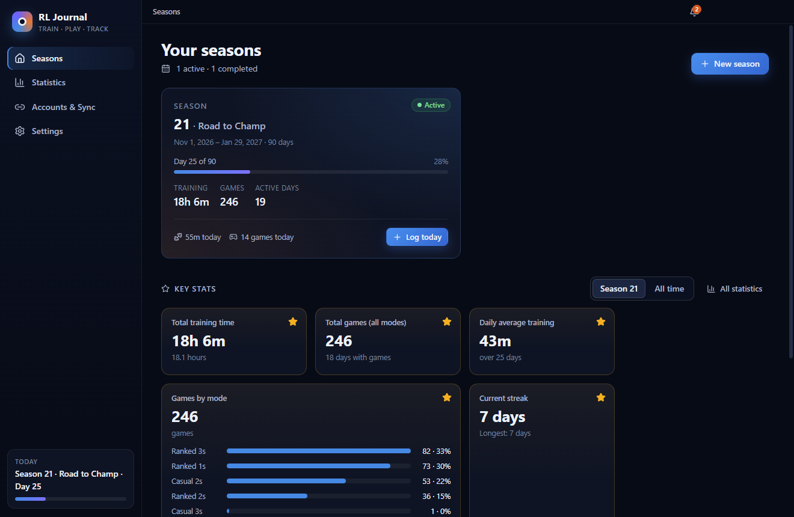

# RL Journal

**A training and games journal for Rocket League, for Windows and Linux.**

Plan your season, log what you practise every day, and let your games log themselves while you play. Then see exactly how much you train, what you play, and how you're doing.



## Download

| | Windows 10 / 11 | Linux (x86_64) |
|---|---|---|
| **File** | `RL-Journal-Setup-<version>.exe` | `RL-Journal-x86_64.AppImage` |
| **Get it** | [Latest release](https://github.com/GAGBI123/rl-journal/releases/latest) | [Download AppImage](https://github.com/GAGBI123/rl-journal/releases/latest/download/RL-Journal-x86_64.AppImage) |

### Install on Windows

1. Download `RL-Journal-Setup-<version>.exe` from the [latest release](https://github.com/GAGBI123/rl-journal/releases/latest).
2. Run it. Windows may say *"Windows protected your PC"* because the app isn't code-signed. Click **More info → Run anyway**.
3. Pick where to install, and RL Journal opens. It's in your Start menu and on your desktop.

### Install on Linux

1. Download [`RL-Journal-x86_64.AppImage`](https://github.com/GAGBI123/rl-journal/releases/latest/download/RL-Journal-x86_64.AppImage). Keep it somewhere permanent, such as `~/Applications`.
2. Allow it to run: right-click → **Properties** → **Permissions** → tick *Allow executing file as program* (or run `chmod +x RL-Journal-x86_64.AppImage`).
3. Double-click it. On first start it adds **RL Journal** to your app menu, so after that you can open it like any other app.

Works on any modern 64-bit distribution (Arch / CachyOS, Fedora, Ubuntu, Debian, openSUSE…), no extra libraries needed.

### Updates

RL Journal updates itself. New versions are downloaded in the background and installed when you're not in a match or using the app, and you get a message when it's done. You can turn that off in **Settings → Updates** and install updates with one click instead.

Your journal is never replaced, not by updates and not by running the installer again.

## Features

### Seasons and days
- Add a season with its number. It gets **90 days** by default.
- Add more days, delete days, or close a season early. Completed seasons are marked as done on the home screen.

### Daily log
- Pick a **section** (Training, Games, or your own), then **what you did**, then **time** (minutes or hours) or **amount**.
- Add an optional **description**, like *"aerials, flicks, air dribbles"*.
- Logging the same thing twice in a day adds to that day's total instead of creating a second entry.
- While you type, you see how it compares to **yesterday**, **your average**, the **season average** and your **best day**, including when you set a new personal best.
- Games start with **Ranked 1s / 2s / 3s**, **Casual 1s / 2s / 3s** and **Honor Duel**. Add your own and put them in any order in Settings.


### Automatic game logging
RL Journal uses Rocket League's official [Stats API](https://www.rocketleague.com/developer/stats-api) to log your games for you while the app is running, even when it's minimized to the tray.

- Every online match you finish is added to today: **ranked or casual**, the **mode**, **win or loss**, the score and your goals, assists, saves and shots.
- **Honor Duels** are logged separately, with their own wins and losses.
- It works out which account you're playing on by itself, so it handles **multiple accounts** with no setup. The top bar shows *Game connected · your account*.
- Freeplay, training, workshop maps and offline games are never logged. Private matches are optional.
- Win/loss tracking can be switched off separately for regular games and for Honor Duels.
- You get a notification for each logged game.

**One-time setup:** open **Accounts & Sync** and click **Enable Stats API**, then restart Rocket League once. The app finds your game automatically, on Windows (Epic or Steam) and on Linux (Steam/Proton, Heroic, Lutris or Bottles). If it can't, choose the folder yourself. It's the one that contains `TAGame`.

### Statistics
- About 50 stats, for each season or all time: total and daily training time, games by mode, ranked vs casual, win rates, Honor Duels, streaks, records, best weekday, goals, saves, shooting % and more.
- Charts for training time and games per mode, plus a table that compares your seasons side by side.
- **Star** the stats you care about most to pin them to the top of Statistics and to your home screen.


### Your data
- Everything is stored locally on your computer. There's no account and no cloud.
  - Windows: `%APPDATA%\RL Journal\journal.json`
  - Linux: `~/.config/RL Journal/journal.json`
- A daily backup is kept for 14 days, and you can export and import backups in Settings.

## Build from source

Requires [Node.js](https://nodejs.org) 22 or newer.

```bash
git clone https://github.com/GAGBI123/rl-journal.git
cd rl-journal
npm install
npm run dev          # run with hot reload
npm test             # unit tests
npm run dist:win     # Windows installer → release/
npm run dist:linux   # Linux AppImage → release/ (run on Linux)
```

Handy for development:

- `node scripts/fake-stats-api.mjs 49124 YourName session` pretends to be Rocket League: freeplay, then a Ranked 3s win, then an Honor Duel. Pass a playlist id instead of `session` for a single match (11 = Ranked 2s, 3 = Casual 3s, 53 = Honor Duel).
- `RLJ_USER_DATA=<folder>` runs the app with a separate data folder.

### Releasing

Bump `version` in `package.json`, commit, and run `npm run release`. It tags the commit. GitHub Actions then builds the Windows installer and the Linux AppImage, tests that the app starts, and publishes the release. Installed apps update from there.

### Project layout

| Folder | What's in it |
|---|---|
| `src/main` | Electron main process: storage, Stats API client, game config setup, updater, Linux integration, tray |
| `src/preload` | The bridge between the app window and the main process |
| `src/renderer` | The React UI. `lib/` holds the journal, statistics and sync logic |
| `src/shared` | Data model and Rocket League playlist list |
| `tests` | Unit tests |
| `.github/workflows` | Windows + Linux builds and releases |

---

RL Journal is a fan-made project. It is not affiliated with or endorsed by Psyonix or Epic Games. Rocket League is a trademark of Psyonix.
